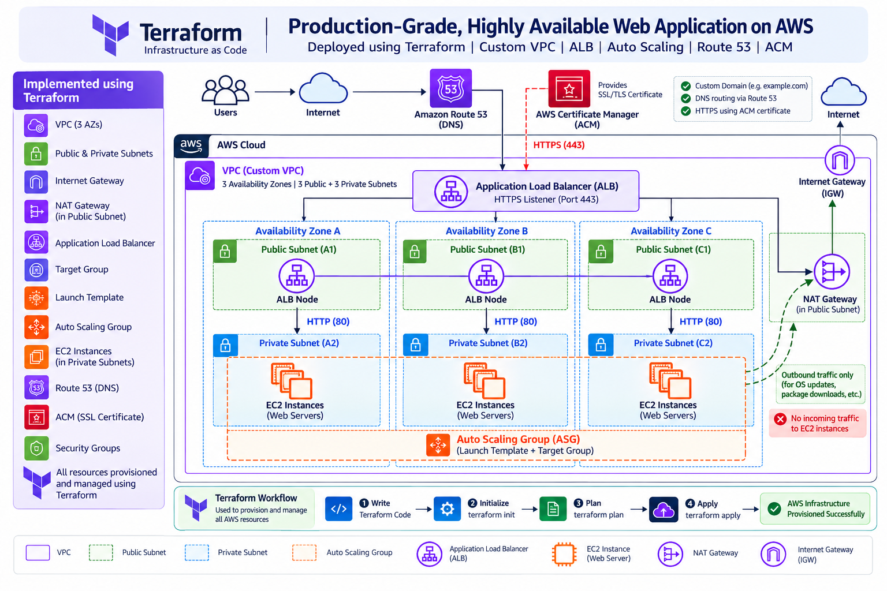

# Production-Grade Highly Available Web Application on AWS

**Terraform · AWS · Custom VPC · Application Load Balancer · Auto Scaling · Route 53 · ACM**

This repository contains Terraform configurations for a production-style, highly available web application architecture on AWS. It is organized into reusable modules and environment-specific configurations.

> **Important:** Verify every component against the Terraform code before describing it as deployed. Confirm the number of Availability Zones, NAT Gateways, HTTPS listener, Route 53 records, and Auto Scaling configuration.

## Architecture



### Request flow

1. Users access the application using its DNS name.
2. Amazon Route 53 resolves the DNS name to the Application Load Balancer.
3. The ALB terminates HTTPS using a certificate provisioned through AWS Certificate Manager (ACM).
4. The ALB forwards HTTP traffic on port 80 to healthy EC2 targets in private subnets.
5. EC2 instances are managed by an Auto Scaling Group and launched from a Launch Template.
6. Private instances can use a NAT Gateway for outbound internet access when subnet routes and security rules permit it. A NAT Gateway does not allow unsolicited inbound internet connections to private instances.

## Key components

| Component | Purpose |
|---|---|
| Amazon VPC | Isolated virtual network |
| Public subnets | Host internet-facing infrastructure such as the ALB and NAT Gateway, according to the deployed design |
| Private subnets | Host EC2 application instances without direct public internet exposure |
| Internet Gateway | Provides internet routing for eligible public-subnet resources |
| NAT Gateway | Allows private-subnet resources to initiate outbound IPv4 connections |
| Application Load Balancer | Receives application traffic and routes requests to registered targets |
| Target Group | Registers EC2 targets and checks their health |
| Launch Template | Defines EC2 launch settings and user data |
| Auto Scaling Group | Maintains configured EC2 capacity and can replace unhealthy instances |
| Amazon Route 53 | DNS records for the application |
| AWS Certificate Manager | TLS certificate used by the ALB HTTPS listener |
| Terraform modules | Reusable infrastructure building blocks |

## Repository structure

This example reflects the currently identified folders. Update it if your repository structure differs.

```text
aws-production-architecture/
├── Environments/
│   ├── DNS/
│   ├── Network/
│   │   └── VPC/
│   │       └── dev/
│   └── compute/
│       ├── acm/
│       └── alb/
│           └── dev/
├── Modules/
├── docs/
│   └── aws-production-architecture.png
├── .gitignore
└── README.md
```

## Prerequisites

- AWS account and permissions for the resources used.
- Terraform CLI and AWS CLI installed.
- AWS CLI authenticated using an approved credential method.
- Git installed.
- A Route 53 domain if deploying public DNS records.
- An issued ACM certificate in the same Region as the ALB for an HTTPS listener.

## Deployment workflow

Run Terraform from the specific environment directory containing the root configuration. The example below uses the ALB development environment; adjust it to match your setup.

```bash
cd Environments/compute/alb/dev
terraform init
terraform plan
terraform apply
```

Review the plan before applying. Networking, DNS, certificates, and compute may need to be deployed in dependency order, depending on how your Terraform configurations and state files are organized.

### Verify AWS identity

```bash
aws sts get-caller-identity
```

Do not hardcode access keys in Terraform files or commit credentials.

### Verify the deployment

- Check VPCs, public/private subnets, route tables, and gateway routes.
- Check the ALB listener and attached security group.
- Check registered targets and target health.
- Check Auto Scaling Group capacity and instance health.
- Check EC2 private IP addresses and web-server status.
- Check Route 53 records and ACM certificate status if configured.

For ALB health-check timeouts, verify the EC2 security group allows the application port from the ALB security group and that network ACLs permit request and return traffic.

## Security practices

- Keep application EC2 instances in private subnets when public IPs are not required.
- Allow application traffic to EC2 from the ALB security group rather than all IPv4 sources.
- Use IAM roles and least-privilege permissions.
- Keep Terraform state files and secrets out of Git.
- Commit `.terraform.lock.hcl` files to preserve provider dependency selections.
- Review `terraform plan` before applying or destroying resources.
- Restrict ingress and egress to what the application requires.

## Cleanup

Destroy only resources managed by the selected Terraform root configuration, after reviewing the impact:

```bash
terraform plan -destroy
terraform destroy
```

Resources may be managed by other environment directories or separate state files. Confirm state ownership and dependencies before cleanup. NAT Gateways and load balancers can incur charges while they exist.

## Troubleshooting

### ALB target health check times out

1. Confirm the web server is running and responds locally on the configured port.
2. Confirm the target is registered on the expected port.
3. Confirm the EC2 security group allows inbound traffic from the ALB security group.
4. Check ALB and EC2 subnet Network ACLs, including ephemeral return ports.
5. Check the health-check protocol, path, port, and success codes.
6. Review user-data and cloud-init logs if the web server did not start.

### DNS or HTTPS does not work

1. Confirm the Route 53 record points to the intended ALB.
2. Confirm the ACM certificate is issued and covers the hostname.
3. Confirm the certificate is in the same Region as the ALB.
4. Confirm the ALB has the expected HTTPS listener and port 443 security-group rule.

## Learning outcomes

- AWS networking with public and private subnets.
- Deploying web workloads behind an Application Load Balancer.
- Launch Templates and Auto Scaling Groups.
- DNS and TLS certificate management.
- Reusable Terraform modules and environment configuration.
- Troubleshooting security groups, routing, and target health.

## Author

**Vishal Konde** — Aspiring DevOps / Cloud Engineer

- GitHub: https://github.com/VishalKonde01
- LinkedIn: linkedin.com/in/vishal-konde-dev


